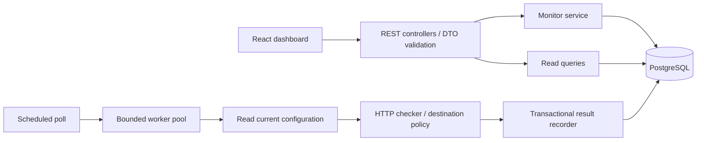

# Architecture

Sentinel is a modular monolith: one Spring Boot process, one PostgreSQL database, and a React client. v0.1 supports exactly one backend instance. The UI polls the REST API every ten seconds and uses no simulated monitoring results.

## Boundaries and control flow

- `monitoring`: configuration, DTOs, CRUD, dashboard summaries, and read APIs.
- `checking`: URL/DNS policy, GET execution, outcome classification, persisted observations.
- `scheduling`: due-monitor selection, admission, per-monitor reservations, bounded execution, shutdown.
- `incidents`: outage history and the transactional check/incident transition boundary.
- `shared`: clock, pagination envelope, and centralized error responses.

The only externally visible model is a DTO. JPA entities are never serialized. Repositories use UUID foreign-key fields rather than navigable entity graphs, preventing accidental lazy loading. Global activity and incident views batch-load monitor names instead of performing one query per row. Latest observations are cached on the monitor in the same transaction as history so list views do not scan history for every monitor.

## Scheduler invariants

1. A monitor ID is reserved in a concurrent set **before** submitting work. Pending and running work share that reservation.
2. Duplicate admissions are skipped. They do not become health results or advance incident counters.
3. A fixed worker count and `ArrayBlockingQueue` bound concurrency and queued work. Saturation uses rejection, not unbounded buffering or caller-runs execution on the timer thread.
4. Rejected submissions release the reservation immediately. Every accepted task releases it in `finally`, including exceptions, disabled/deleted monitors, and expired queue entries.
5. Workers discard tasks older than `max-queue-age` (default ten seconds), then re-read the monitor. They never use configuration captured when a task first entered the queue.
6. A saved result sets `next_check_at` to completion time plus the configured interval. This is fixed delay, not fixed rate. There is no backlog or catch-up burst after downtime.
7. A bounded due query selects up to twice worker-plus-queue capacity, sorted by due time and UUID. This allows progress past reserved monitors while avoiding a whole-table load.
8. Shutdown stops admission, drains pending tasks, and grants active tasks 32 seconds to finish. The maximum configured request timeout is 30 seconds. Remaining work is interrupted; the HTTP client is subsequently closed.

System DNS resolution is an explicit exception to a strict shutdown/deadline guarantee: the OS/JVM resolver may not respond to interruption. Bounded workers prevent unlimited thread creation, but sufficiently many stalled lookups can exhaust useful checking capacity. A future hardened deployment should use a resolver with a strict deadline and network-level egress policy.

Reservations live only inside one process. The PostgreSQL row lock serializes result recording, **not outbound request ownership**. Running two backend instances would therefore execute duplicate checks and could advance failure counters too quickly. Scaling requires database leases/claims with expiry and fencing (or a dedicated scheduler), not merely the existing unique incident index.

## Incident transitions and transaction boundary

| Existing condition | Observation | Result |
| --- | --- | --- |
| 0–1 consecutive failures | DOWN | Increment count, remember first failure |
| 2 consecutive failures | DOWN | Open incident starting at the first failure |
| Open incident | DOWN | Keep it open; saturate counter at 3 |
| Any failure count | UP or DEGRADED | Reset counter and first-failure timestamp |
| Open incident | UP or DEGRADED | Set recovery timestamp |
| Pending/active work skipped | No observation | No state change |

`ResultRecorder.record` runs in one transaction. It locks the monitor row with `SELECT … FOR UPDATE`, verifies that it remains enabled and has the same configuration revision, updates latest state/counters/due time, persists the check, and opens or closes the incident. Any failure rolls back all changes. CRUD mutations acquire the same row lock. Network I/O happens **outside** the database transaction.

The partial unique index `one_open_incident_per_monitor` enforces one active incident even if application logic regresses. Deletion cascades through check and incident history. An in-flight result after deletion is ignored. Configuration edits, including pause/resume, increment a revision so stale results cannot contaminate new configuration.

Pausing or editing a monitor is not evidence of recovery: existing incidents and the consecutive-failure sequence remain. On resume, new observations continue the logical monitor's sequence. Editing a URL keeps the same logical monitor and history; create a new monitor if it represents a different service. No configuration-version history is retained in v0.1.

Timestamps are UTC instants stored as `timestamptz`. Incident start uses the first failed check's **start timestamp**; recovery uses the recovery check's start timestamp. Duration is computed, including ongoing duration for active incidents, instead of persisting a value that becomes stale. A backwards wall-clock correction clamps duration to zero. Elapsed request duration uses `System.nanoTime`, so wall-clock changes cannot produce negative latencies.

## HTTP semantics and SSRF boundaries

A check is a GET to response headers; it does not validate or consume the body. A 2xx is UP at or below the threshold and DEGRADED above it. Every other HTTP status, including redirects, is DOWN with `HTTP_ERROR`. DNS failures, timeouts, blocked destinations, TLS errors, and connection failures have separate reason codes and null HTTP status. Failed-request duration means elapsed time until failure, not successful server latency.

Apache HttpClient uses a custom `DnsResolver` for connection establishment. Admission validation rejects malformed/non-HTTP URLs, credentials, fragments, invalid ports, and private/non-public resolution. The entire DNS answer is rejected if any address is non-public. Before every request, literal IPs are also checked, because a client may bypass DNS resolution for numeric hosts. Fresh connections avoid reusing a connection across DNS changes; the connection operator receives the validated `InetAddress` values. Hostnames remain intact for Host headers, TLS SNI, and certificate validation. Redirects, automatic retries, cookies, system proxy discovery, and connection reuse are disabled.

A scheduled cancellation imposes a total HTTP operation budget in addition to connection, pool-acquisition, and response timeouts. The OS DNS limitation above still applies. Response streams are immediately closed without body buffering. Conservative IP filtering includes IPv4 private/shared/link-local/reserved/documentation space and IPv6 local, multicast, documentation, and transition ranges. This can intentionally reject unusual legitimate public destinations.

`dev`/`test` may explicitly allow exact local hostnames. Wildcards and global private-address bypasses are not provided. A nonempty allowlist outside those profiles fails startup. An approved name is trusted to resolve locally and therefore deliberately bypasses public-address filtering; never enable such exceptions on an exposed application.

This is defense in depth, not a safe public URL-fetching service. Custom routes, NAT, network proxies outside the process, future special-use address assignments, DNS stalls, and access to a public service that itself proxies internal data remain beyond this filter's guarantees. Use network egress controls and independently review the policy before broader deployment. Authentication and authorization are absent. Bind to loopback, use only trusted local users, and do not expose the API publicly.

Logs use monitor IDs and exception classes, not full URLs or exception messages. HTTP wire logging is disabled, and Spring request logging is constrained. URLs, including query strings, are still stored and returned to the trusted UI; do not put secrets in them. Enabling verbose framework/database logging can reveal payloads and should be avoided.

## Persistence and API trade-offs

Flyway owns schema creation; Hibernate only validates it. Check and incident history have `(monitor_id, timestamp DESC, id DESC)` indexes; global recent views have time indexes. The UUID tie-breaker keeps page ordering deterministic when timestamps match. History and monitor list APIs cap page size at 100. Offset pagination is appropriate for this MVP, but concurrent new records can shift page boundaries. Large histories should use cursor pagination and a retention policy.

Overview status counts refer to last observed status, including paused monitors; unchecked monitors are explicitly pending. Active incidents are independent of the current status threshold, so DOWN can appear before an incident opens. Read models under READ COMMITTED can reflect adjacent committed snapshots across queries; they are not an atomic monitoring snapshot.

Bounded execution sacrifices checks under load to protect process resources. There is no uptime percentage calculation because skipped work is not evidence of downtime or uptime. No delivery queue, alert notifications, retention job, authentication, or multi-instance coordination is implemented.

## Frontend

Routes cover overview, monitor details/configuration, and incident history. The API client owns base URL selection, JSON requests, errors, and typed response models. `useResource` owns cancellation, loading/error state, and polling after a request completes, preventing overlapping polls and stale navigation results. Mutation state stays local to the affected page/form. Forms preserve input on API rejection.

Recharts is loaded on demand for the detail view. Points are chronological, missing durations are gaps, and failed observations use red markers with explanatory text and an accessible table of exact values. Tables, status labels, and incident labels remain readable without relying on color. Both Vite and nginx proxy `/api` so normal use needs no permissive CORS policy.

## Engineering references

- [Spring Boot 3.5 system requirements](https://docs.spring.io/spring-boot/3.5/system-requirements.html)
- [Apache HttpClient DNS resolver API](https://hc.apache.org/httpcomponents-client-5.5.x/current/httpclient5/apidocs/org/apache/hc/client5/http/DnsResolver.html)
- [PostgreSQL partial indexes](https://www.postgresql.org/docs/17/indexes-partial.html)
